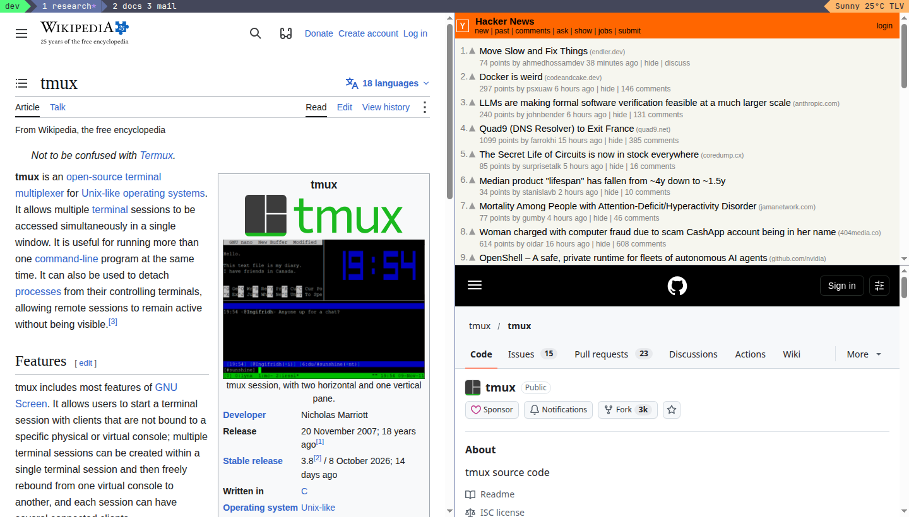
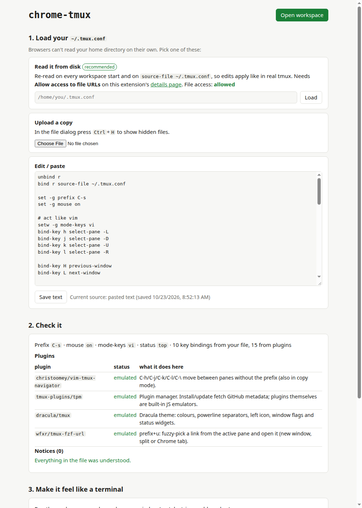
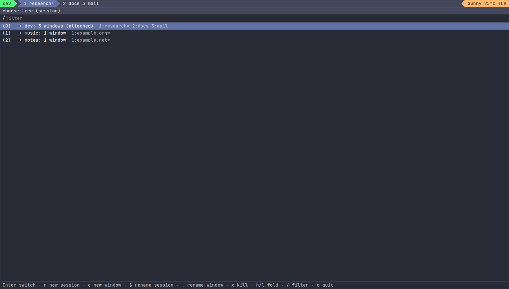
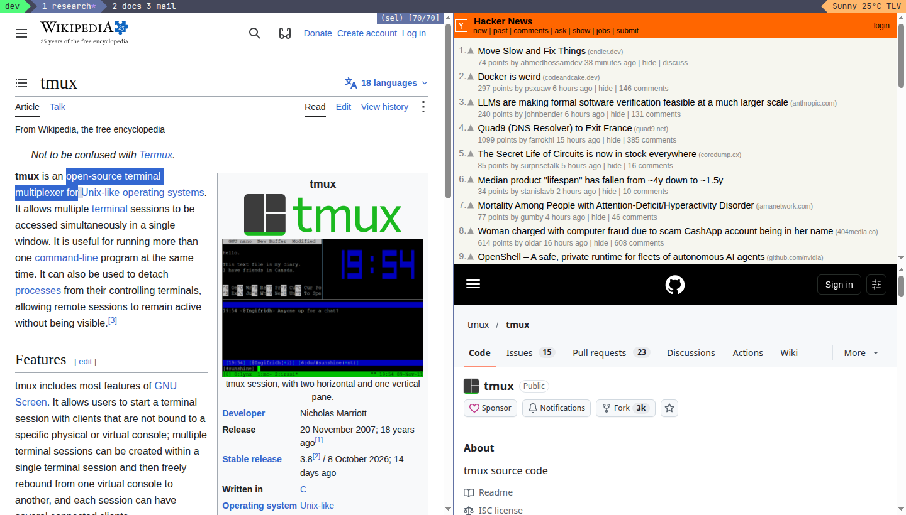
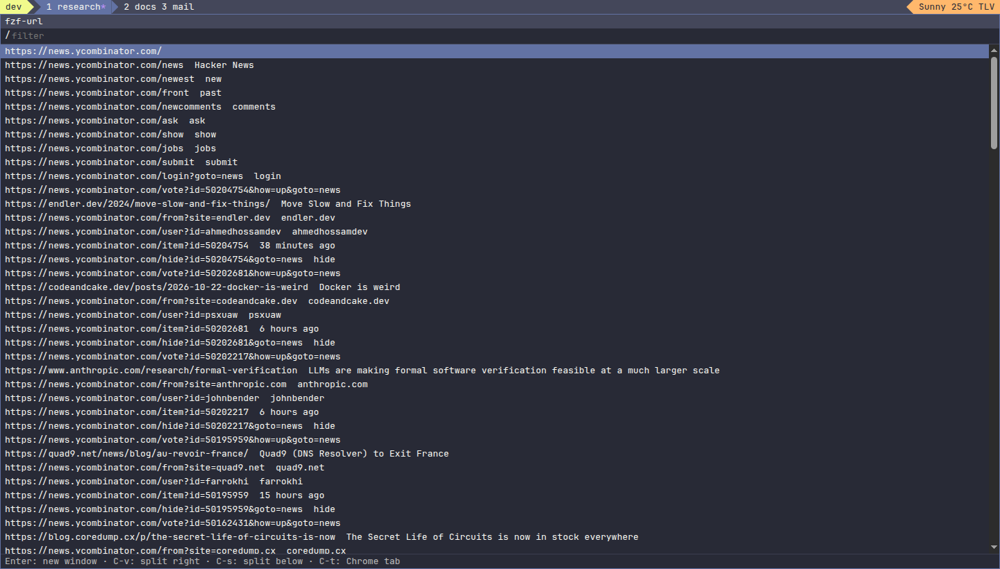
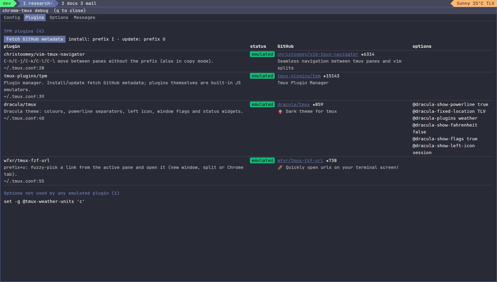

# chrome-tmux

tmux inside Chrome. A Manifest V3 extension that turns a tab (or a chromeless
`--app` window) into a tmux client. Panes hold web pages, and you get windows,
sessions, a status line, copy mode and modal key bindings. It is configured by
your real `~/.tmux.conf`, including TPM plugins.



*A real `~/.tmux.conf` (prefix `C-s`, Dracula theme, status line on top) driving three
panes. Window list on the left, the Dracula weather widget on the right.*

## Install

1. Build it once: `npm install && npm run build` (or `make build`). The sources are TypeScript and
   compile in place to the `.js` files Chrome loads.
   Then `chrome://extensions` → enable **Developer mode** → **Load unpacked** → pick this folder.
2. The options page opens. Load your config, either by path (recommended) or by upload or paste.
   For the path option, enable **Allow access to file URLs** on the extension's details page
   and enter an absolute path such as `/home/you/.tmux.conf`. The file is then re-read on every
   start and on `source-file ~/.tmux.conf`, like real tmux.

   <details><summary>Options page: the config is parsed and checked before you use it</summary>

   
   </details>

3. Click the toolbar icon (or press <kbd>Alt</kbd>+<kbd>Shift</kbd>+<kbd>T</kbd>) to open the workspace.
   For a terminal-like window with no tab strip or address bar:

   ```sh
   google-chrome --app=chrome-extension://<extension-id>/src/workspace/workspace.html
   ```

   The options page shows the exact command with your extension ID filled in.

A new pane starts as a prompt: type a URL, search terms, or `:command` for any tmux command.

## What works

| Area | Supported |
|---|---|
| Config syntax | quoting rules, `\` continuations, `;` and `\;`, `{ }` blocks, `NAME=value` and `$NAME`/`${NAME}`, `%if/%elif/%else/%endif`, `%hidden`, `source-file`, deprecated `*-fg/-bg/-attr` options, array options (`command-alias[N]`, `terminal-overrides`, `status-format[N]`, `set -a` appends) |
| Shell | `if-shell`, `run-shell` and `display-popup` run a small built-in shell (see [Shell commands](#shell-commands)), so version checks, `[ … ]` tests and `tmux set/bind/show …` calls work |
| Hooks | `set-hook [-a/-u/-R]` with array indexes, `show-hooks`; `after-<command>` and session/window/pane events actually fire (`session-created`, `window-linked`, `window-renamed`, `client-session-changed`, `pane-focus-in/out`, `window-layout-changed`, `client-attached`, …) with `#{hook_*}` formats |
| Keys | `prefix`/`prefix2`, prefix/root/custom tables (`bind -n`, `-T`, `switch-client -T`), repeat (`-r`, `repeat-time`), `unbind [-a]` |
| Panes | `split-window [-h/-v/-b/-f/-l/-p/-c]`, `select-pane -L/R/U/D/-l/-t`, marked panes (`select-pane -m/-M`, `prefix m/M`, `~`/`{marked}` targets, the `M` window flag, default source for `join-pane`/`swap-pane`/`swap-window`), `resize-pane` (keys, `-x/-y`, `-Z` zoom, mouse-drag borders), `swap-pane`, `rotate-window`, `break-pane`, `join-pane`, `kill-pane`, `display-panes`, `pane-border-status` |
| Windows | `new-window`, `select-window`, `next/previous/last-window`, `rename-window`, `swap-window`, `move-window`, `kill-window`, `base-index`, `renumber-windows`, `automatic-rename` (uses the site hostname) |
| Layouts | `even-horizontal`, `even-vertical`, `main-horizontal`, `main-vertical`, `tiled`, `next-layout`, `select-layout -E/-o` |
| Sessions | `new-session`, `rename-session`, `switch-client -n/-p/-l/-t`, `kill-session`, `detach-client`; `prefix s` / `prefix w` (choose-tree) is a session manager: `Enter` switch, `(0)`–`(9)` shortcuts, `n` new session, `c` new window, `$` / `,` rename session/window, `x` kill, `h/l` fold, `/` filter |
| Status line | `status-left/right` (with `-length`/`-style`), `window-status-*format/style`, `status-justify`, `status-position`, `status-interval`, `message-style`, full `#{}` format language (including `#{S:}`/`#{W:}`/`#{P:}` loops, `#{N/w:}`, `#{!:}`, `#{a:}`, `#{c:}`, `#{w:}`, any option name as a variable, `client_width`, `pane_at_left`, …), `#[]` styles, 256/hex colours, strftime. Powerline glyphs are drawn with CSS, so no patched font is needed |
| Modes | `command-prompt` (`-p/-I/-1`, history, Tab completion), `confirm-before`, `display-menu` (shortcut keys, disabled items, separators; `prefix <` / `>` window and pane menus), `display-popup` (a URL opens in a floating frame), `display-message`, `list-keys [-N]`, `show-options`, `show-messages`, `clock-mode`, `choose-buffer`, `find-window` |
| Copy mode | `copy-mode-vi` / `copy-mode` tables from your config. The page caret is the cursor, moved with the DOM Selection API (`h j k l w b e 0 $ g G H M L C-u C-d …`), with `/ ? n N` search, `Space`/`V` selection and `Enter`/`y` to copy to the clipboard and a paste buffer |
| Web | `goto`/`open <url>`, `back`, `forward`, `reload`, `open-in-tab`, `paste-buffer`, `send-keys` (text), `capture-pane` (the page's text) |
| Other commands | every tmux 3.4 command name resolves. `wait-for` (`-S/-L/-U`), `save-buffer` (to the clipboard), `load-buffer`, `set-buffer -n`, `list-clients`, `command-alias`; terminal-only ones (`pipe-pane`, `resize-window`, `start-server`, …) are accepted and do nothing |

Extra default bindings, for things a browser needs: `prefix g` opens a URL in the pane,
`prefix B` goes back, `prefix T` opens the pane in a real Chrome tab.

State lives in `chrome.storage.session`, like a tmux server: it survives reloading
the workspace but not restarting Chrome. Use resurrect/continuum to persist across restarts.

### A quick tour

<table>
<tr>
<td width="50%"><a href="docs/screenshots/sessions.png"></a><br>
<b>Session manager</b> (<code>prefix s</code>): switch, create (<code>n</code>), rename (<code>$</code>), kill (<code>x</code>).</td>
<td width="50%"><a href="docs/screenshots/copy-mode.png"></a><br>
<b>Copy mode</b> (<code>prefix [</code>): vi keys, <code>/</code> search and a selection in a live page; <code>Enter</code> copies it.</td>
</tr>
<tr>
<td><a href="docs/screenshots/fzf-url.png"></a><br>
<b>tmux-fzf-url</b> (<code>prefix u</code>): every link on the page in a fuzzy picker.</td>
<td><a href="docs/screenshots/plugins.png"></a><br>
<b>TPM emulation</b> (<code>prefix ~</code>): which plugins are emulated, their options, GitHub metadata.</td>
</tr>
</table>

## TPM plugins

TPM plugins are shell scripts, which a browser can't run. Instead, `set -g @plugin '…'`
lines are collected, and `run '~/.tmux/plugins/tpm/tpm'` applies built-in JS emulators.
If the `run` line is missing, they are applied at the end of the config. `prefix I` / `U`
fetch each plugin's metadata from the GitHub API (cached for 24h) for the debug panel.

| Plugin | Emulation |
|---|---|
| `tmux-plugins/tpm` | `prefix I/U/M-u`: install/update/clean = fetch or clear GitHub metadata |
| `tmux-plugins/tmux-sensible` | option defaults (never overriding yours), `C-p`/`C-n`, `R` reload, prefix-letter `send-prefix` |
| `tmux-plugins/tmux-resurrect` | `prefix C-s`/`C-r` save/restore sessions, windows, layouts, split ratios and URLs in `chrome.storage.local` |
| `tmux-plugins/tmux-continuum` | auto-save every `@continuum-save-interval` minutes, `@continuum-restore 'on'`, `#{continuum_status}` |
| `tmux-plugins/tmux-yank` | `y` in copy mode copies to the system clipboard; mouse selections are copied when `mouse on`; `prefix y` copies the URL, `prefix Y` a Markdown link |
| `tmux-plugins/tmux-pain-control` | `h j k l`, `H J K L` (repeatable resize), `\| - \\ _` splits, `< >` window moves |
| `christoomey/vim-tmux-navigator` | `C-h/j/k/l/\` without the prefix (web pages are never vim, so these always move panes) |
| `dracula/tmux` | full theme from `dracula.sh`: powerline, flags, left icon, colours; `time`, `weather` (wttr.in), `battery`, `network` widgets |
| `wfxr/tmux-fzf-url` | `prefix u`: fuzzy-pick any link or URL on the page, then open it in a new window, a split (`C-v`/`C-s`) or a Chrome tab (`C-t`) |
| `tmux-plugins/tmux-prefix-highlight` | `#{prefix_highlight}` |
| `tmux-plugins/tmux-battery` | `#{battery_percentage}`, `#{battery_icon}`, `#{battery_status}`, `#{battery_remain}` |
| `tmux-plugins/tmux-online-status` | `#{online_status}` |

Unknown plugins are listed in the debug panel (`prefix ~`, Plugins tab) together with
the `@options` they would have used. So are config lines whose shell commands are outside
the built-in shell below, and `#()` in formats.

### Shell commands

There is no `/bin/sh` in a browser, but the shell snippets in real configs and plugins
are a small, familiar set. `if-shell`, `run-shell` and `display-popup` run them with a
built-in POSIX-shell subset (`src/core/shell.ts`):

- `;`, `&&`, `||`, `|`, `!`, quoting, `$VAR`/`${VAR:-x}`, `$(…)` and backticks, `>/dev/null 2>&1`
- `tmux …` runs the tmux command in this engine, and its output can be captured:
  `$(tmux show -gqv @opt)`, `tmux display -p '#{…}'`, `tmux -V` (prints `tmux 3.4`)
- `test`/`[ ]`/`[[ ]]`, `echo`, `printf`, `true`/`false`, `uname` (your OS), `command -v`/`which`,
  `cut`, `grep`, `sed s///`, `tr`, `awk '{print $N}'`, `bc` comparisons, `head`, `tail`, `wc`, `sort`, `sh -c`
- `$TMUX` and `$TMUX_PANE` are set, as inside real tmux

So the usual idioms work:

```tmux
run-shell 'tmux setenv -g TMUX_VERSION $(tmux -V | cut -c 6-)'
if-shell -b '[ "$(echo "$TMUX_VERSION >= 2.1" | bc)" = 1 ]' 'set -g mouse on'
if-shell 'test "$(uname)" = "Darwin"' 'set -g default-command "reattach-to-user-namespace -l $SHELL"'
bind f display-popup -E "tmux new -A -s scratch"        # the scratch-session popup
bind D display-popup -w 80% -h 80% https://devdocs.io   # a URL opens in the popup
```

File tests (`[ -f ~/.tmux.local ]`) are false, since there is no file system. Anything
else (`ps`, `if … fi`, unknown programs) makes the whole command fall back to the old
behaviour: the condition is false and the debug panel says why.

## How it works

```
manifest.json
tsconfig*.json                   TypeScript config (src: browser; tests + tools: Node)
src/                             TypeScript, compiled in place to .js by `npm run build`
  background/service-worker.ts   DNR session rule: strip X-Frame-Options + CSP on sub_frame
                                 responses, scoped (tabIds) to workspace tabs only
  content/pane-agent.ts          runs in pane iframes: key routing, URL/title reports,
                                 copy mode (Selection API), paste, link collection
  shared/keys.ts                 tmux key names + key-table router (shared by page and agent)
  shared/config-source.ts        tmux.conf from a file:// path or stored text
  core/                          UI-independent engine (unit-tested in Node)
    parser.ts                    tmux config/command tokenizer, getopt
    format.ts                    #{formats}, #[styles], colours, strftime
    layout.ts                    split tree: geometry, navigation, resize, preset layouts
    server.ts                    sessions → windows → panes, snapshots
    target.ts                    -t target resolution (session:window.pane, %id, {last}, …)
    commands.ts                  91 tmux commands (+ aliases)
    shell.ts                     POSIX-shell subset for if-shell / run-shell / display-popup
    defaults.ts                  tmux 3.4 default options and key tables
    tmux.ts                      engine: options, key tables, sourcing, dispatch
  tpm/tpm.ts, tpm/plugins/*      TPM emulation layer + plugin emulators
  workspace/                     the tmux "client" page: status line, panes, overlays
  options/                       config loader + parse report
tests/                           unit tests (node --test, incl. a real-world tmux.conf) + e2e/smoke.mts
tools/                           icon generator, packaging
```

Key routing: pressing the prefix inside a web page is caught by the pane agent at
`keydown` (capture phase, `document_start`). The agent mirrors the key tables
(published to `chrome.storage.local`), so it knows which keys to swallow synchronously.
It then sends `{table, key}` to the workspace with `chrome.runtime.sendMessage`. Page
scripts can't forge these messages. Iframes are never moved in the DOM, so switching
windows or layouts doesn't reload pages.

## Limitations

- **Reserved browser shortcuts.** Chrome doesn't let pages intercept <kbd>Ctrl</kbd>+<kbd>T</kbd>/<kbd>W</kbd>/<kbd>N</kbd>/<kbd>Tab</kbd>, so those can't be tmux keys. App mode (`--app`) frees up a few more.
- **Some sites won't work in a frame** even with the headers stripped: Google sign-in, sites that detect framing in JavaScript, and pages whose cookies Chrome treats as third-party (you may look logged out). `prefix T` opens the pane in a normal tab.
- **Pages without the agent** (Chrome error pages, the PDF viewer, `chrome://` URLs, which can't be framed at all) don't see the prefix while focused. Click the status line to give keys back to the workspace.
- **Copy mode** uses the page's text layout: no rectangle selection, and `cursor-up/down` follow rendered lines.
- **Security trade-off.** Inside workspace tabs, the framed pages lose their `Content-Security-Policy` and `X-Frame-Options` headers. Normal browsing is unaffected, because the rule is scoped to workspace tab IDs.
- **No New Tab override by default**, to avoid taking over every new tab. To get one, add `"chrome_url_overrides": { "newtab": "src/workspace/workspace.html" }` to `manifest.json`.

## Development

`make` lists every task. The main ones:

| Command | What it does |
|---|---|
| `make run` | Launches Chromium with the extension loaded (separate dev profile) and opens the options page and workspace |
| `make app` | Opens the workspace as a chromeless `--app` window in your everyday Chrome (extension loaded there via *Load unpacked*) |
| `make build` | Compiles the TypeScript sources in place (`src/**/*.ts` → `.js`); `make run`, `app`, `test`, `e2e` and `package` build first |
| `make check` | Type-check, unit tests and the browser test |
| `make typecheck` / `make test` / `make e2e` | Each of those on its own |
| `make package` | Builds `dist/chrome-tmux-<version>.zip` |
| `make info` | Prints the extension ID, workspace URL and the browsers found |
| `make screenshots` | Regenerates the README images in `docs/screenshots/` (needs network: it loads real sites) |

The extension ID of an unpacked extension is derived from its folder path, so the
Makefile computes the workspace URL itself. Override the browsers with
`make run CHROMIUM=…` or `make app CHROME=…`.

`make app` finds the Chrome profile that has chrome-tmux installed and opens the
workspace there. If none does, it prints the one-time *Load unpacked* steps.
On Ubuntu 23.10+, AppArmor blocks the sandbox of Playwright's Chromium, so `make run`
starts its throwaway dev profile with `--no-sandbox` (pass `RUN_FLAGS=` to disable).
Use that profile only for development, not everyday browsing.

The same tasks as npm scripts:

```sh
npm install         # TypeScript, Chrome/Node types, playwright-core
npm run build       # compile src/, tests/ and tools/ in place
npm run typecheck   # tsc --noEmit over everything
npm test            # unit tests: parser, formats, layouts, engine, TPM, resurrect
npm run e2e         # loads the extension into Chromium and drives it with real keys
npm run package     # dist/chrome-tmux-<version>.zip
npm run icons       # regenerate icons/
```

`npm run e2e` needs Chromium rather than branded Chrome, which ignores `--load-extension`.
It uses `CHROME_PATH` or the newest Playwright Chromium in `~/.cache/ms-playwright`.
Set `SCREENSHOTS=/some/dir` to keep screenshots of each screen.

Debugging: the workspace exposes `window.ctmux` in DevTools (`ctmux.t` is the engine).
